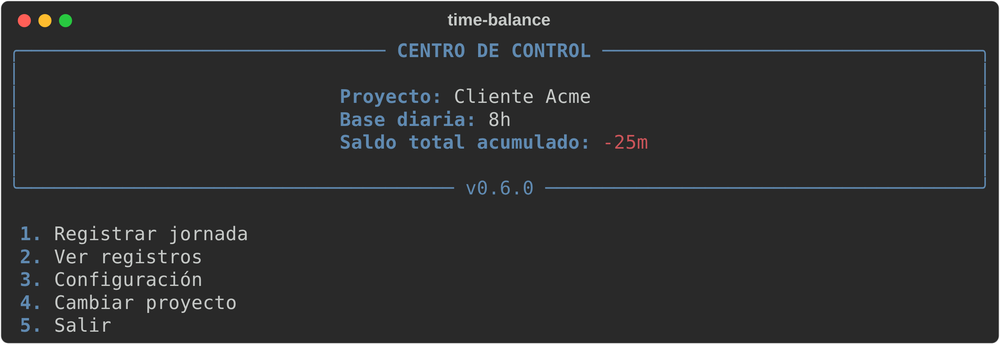
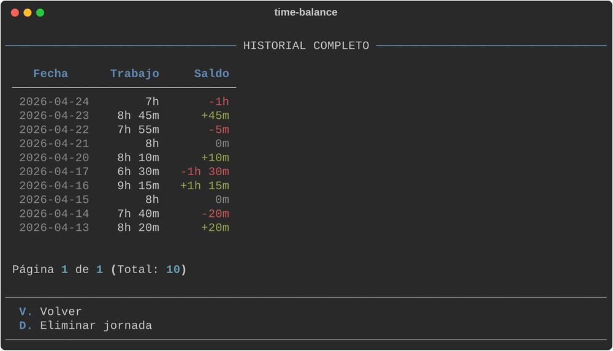

# time-balance

Una pequeña herramienta de terminal para registrar tus jornadas y llevar tu saldo de horas, con un proyecto por contexto.

[Read in English](README.md)

> **Estado del proyecto: terminado.** time-balance fue el primer boceto de una idea más grande. Esa idea acabó siendo **[time-tracker](https://time-tracker.jnfire.dev/)**, una aplicación web con tareas, bloques de tiempo reales, historial auditable y mucho más. time-balance se queda aquí como la versión limpia y final de ese primer experimento: funciona, está probada y no se prevén funciones nuevas.



## Qué hace

- **Registra una jornada** en horas y minutos y la compara con tu base diaria.
- **Mantiene un saldo acumulado**: cuántas horas llevas de más o de menos, por proyecto.
- **Varios proyectos**, cada uno con su base diaria y sus propios registros.
- **Historial** con paginación y borrado de un día con confirmación.
- **Exportar e importar** el historial de un proyecto en un archivo JSON ([formato](docs/es/DATA-FORMAT.es.md)).
- **Español e inglés**, detectados desde tu sistema o elegidos en la configuración.
- **Solo local**: un archivo SQLite en tu equipo, sin cuentas y sin red.



## Instalación

Requiere Python 3.10 o superior. Lo más cómodo es [uv](https://docs.astral.sh/uv/), que además instala Python si no lo tienes.

Descarga el wheel de la [última versión](https://github.com/jnfire/time-balance/releases/latest) e instálalo como herramienta:

```bash
uv tool install ./time_balance-0.6.0-py3-none-any.whl
```

O instálalo directamente desde la release, sin descargar nada antes:

```bash
uv tool install https://github.com/jnfire/time-balance/releases/download/v0.6.0/time_balance-0.6.0-py3-none-any.whl
```

Para probarlo una vez sin instalarlo, usa `uvx --from ./time_balance-0.6.0-py3-none-any.whl time-balance`. Si prefieres `pipx` o `pip`, `pipx install ./time_balance-0.6.0-py3-none-any.whl` funciona igual.

Desde el código fuente:

```bash
git clone https://github.com/jnfire/time-balance.git
cd time-balance
uv run time-balance
```

## Uso

```bash
time-balance              # menú interactivo
time-balance --status     # saldo acumulado del proyecto activo
time-balance --list 10    # últimos 10 registros
time-balance --lang es    # forzar el idioma
```

En el menú, los números eligen una acción y las letras navegan: `V` vuelve atrás y `N` y `P` cambian de página en el historial.

Los saldos se muestran como `+1h 15m`, `-25m` o `0m`.

## Dónde se guardan los datos

Un único archivo SQLite llamado `time_balance.db`:

| Sistema | Carpeta |
| --- | --- |
| Linux | `~/.local/share/time-balance` (o `$XDG_DATA_HOME/time-balance`) |
| macOS | `~/Library/Application Support/time-balance` |
| Windows | `%APPDATA%\time-balance` |

## Desarrollo

El código está tipado y comprobado con ruff y mypy, y tiene 151 tests (96 % de cobertura). Los comandos están en la [guía de desarrollo](docs/es/DEVELOPMENT.es.md).

## Documentación

- [Evolución](docs/evolution/README-es.md): cómo ha cambiado el proyecto, por qué existe y qué se probó
- [Guía de uso](docs/es/CLI-GUIDE.es.md)
- [Formato de los datos](docs/es/DATA-FORMAT.es.md)
- [Arquitectura](docs/es/ARCHITECTURE.es.md)
- [Desarrollo](docs/es/DEVELOPMENT.es.md)
- [Registro de cambios](CHANGELOG.md)

## Licencia

Software libre bajo la [GNU GPL v3.0](LICENSE).
