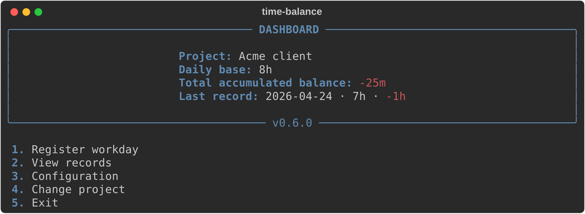
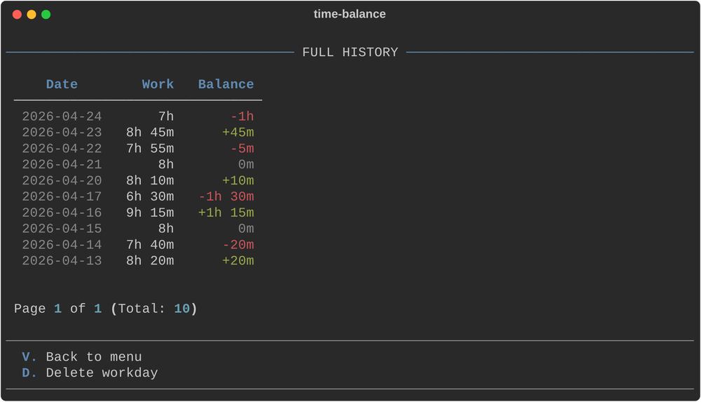

# time-balance

A small terminal tool to register your workdays and keep your hour balance, with one project per context.

[Leer en español](README.es.md)

> **Project status: finished.** time-balance was the first sketch of a bigger idea. That idea became **[time-tracker](https://time-tracker.jnfire.dev/)**, a web application with tasks, real time blocks, an audit history and much more. time-balance stays here as the clean, final version of that first experiment: it works, it is tested, and no new features are planned.



## What it does

- **Registers a workday** as hours and minutes and compares it with your daily base.
- **Keeps an accumulated balance**: how many hours you are ahead or behind, per project.
- **Several projects**, each with its own daily base and its own records.
- **History** with pagination, and deletion of a day with confirmation.
- **Export and import** the history of a project as a JSON file ([format](docs/DATA-FORMAT.md)).
- **English and Spanish**, detected from your system or chosen from the settings.
- **Local only**: one SQLite file on your computer, no accounts and no network.



## Install

Requires Python 3.10 or newer. The easiest way is [uv](https://docs.astral.sh/uv/), which installs Python too if you do not have it.

Download the wheel from the [latest release](https://github.com/jnfire/time-balance/releases/latest) and install it as a tool:

```bash
uv tool install ./time_balance-0.6.0-py3-none-any.whl
```

Or install it straight from the release, without downloading anything first:

```bash
uv tool install https://github.com/jnfire/time-balance/releases/download/v0.6.0/time_balance-0.6.0-py3-none-any.whl
```

To try it once without installing it, use `uvx --from ./time_balance-0.6.0-py3-none-any.whl time-balance`. If you prefer `pipx` or `pip`, `pipx install ./time_balance-0.6.0-py3-none-any.whl` works the same way.

From the source code:

```bash
git clone https://github.com/jnfire/time-balance.git
cd time-balance
uv run time-balance
```

## Use

```bash
time-balance              # interactive menu
time-balance --status     # accumulated balance of the active project
time-balance --list 10    # last 10 records
time-balance --lang es    # force the language
```

In the menu, numbers choose an action and letters navigate: `V` goes back, `N` and `P` change the page of the history.

Balances are shown as `+1h 15m`, `-25m` or `0m`.

## Where the data lives

One SQLite file called `time_balance.db`:

| System | Folder |
| --- | --- |
| Linux | `~/.local/share/time-balance` (or `$XDG_DATA_HOME/time-balance`) |
| macOS | `~/Library/Application Support/time-balance` |
| Windows | `%APPDATA%\time-balance` |

## Development

The code is typed and checked with ruff and mypy, and has 151 tests (96% coverage). See the [developer guide](docs/DEVELOPMENT.md) for the commands.

## Documentation

- [Evolution](docs/evolution/README.md): how the project has changed, why it exists and what was tried
- [Usage guide](docs/CLI-GUIDE.md)
- [Data format](docs/DATA-FORMAT.md)
- [Architecture](docs/ARCHITECTURE.md)
- [Development](docs/DEVELOPMENT.md)
- [Changelog](CHANGELOG.md)

## License

Free software under the [GNU GPL v3.0](LICENSE).
